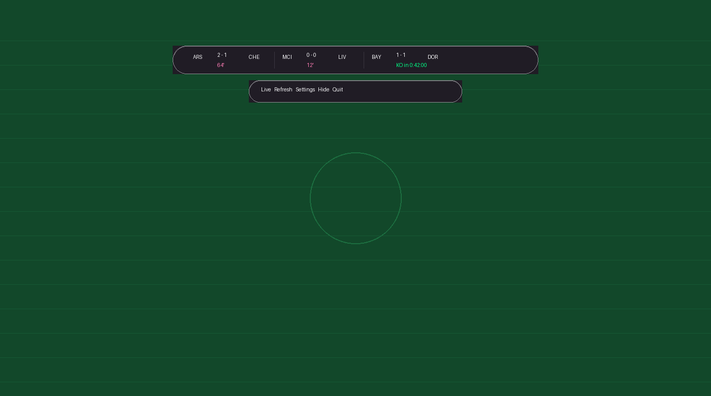
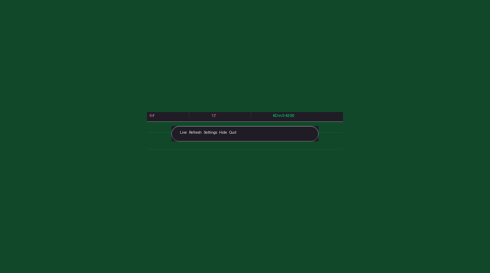
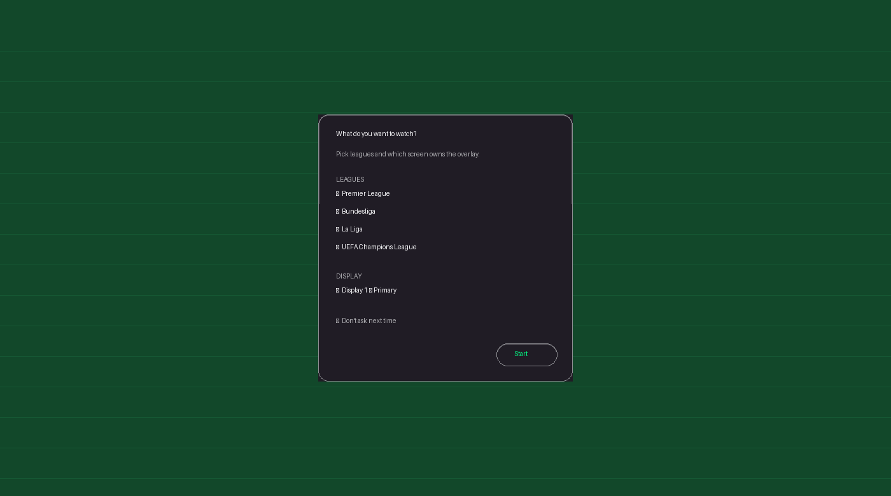
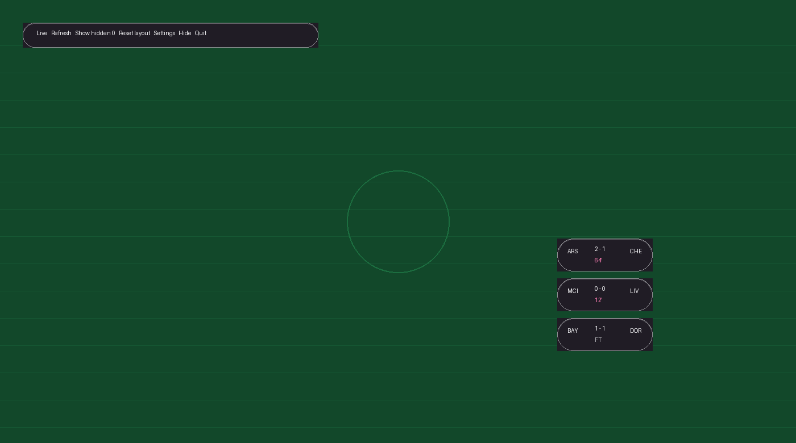
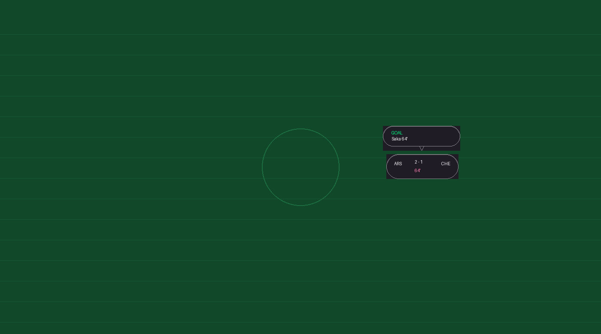
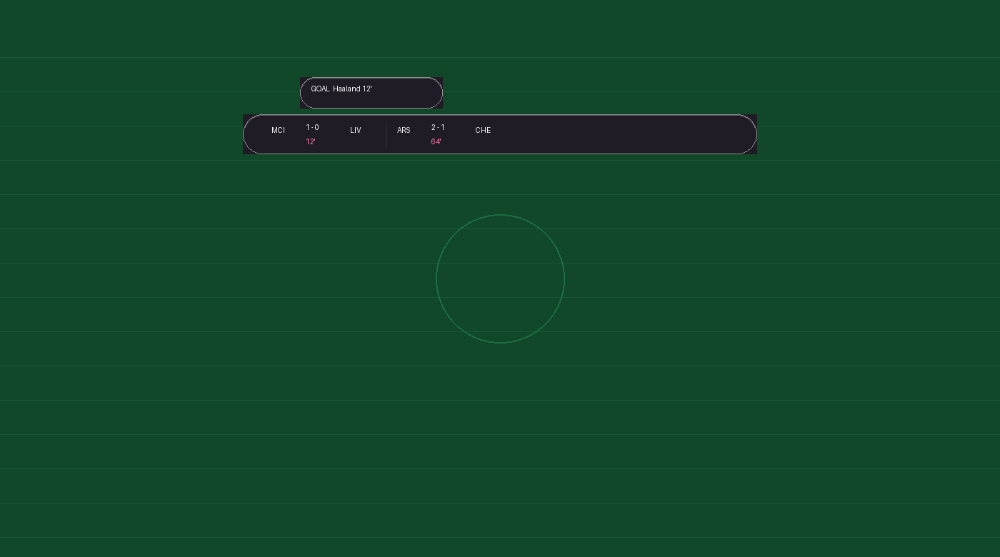
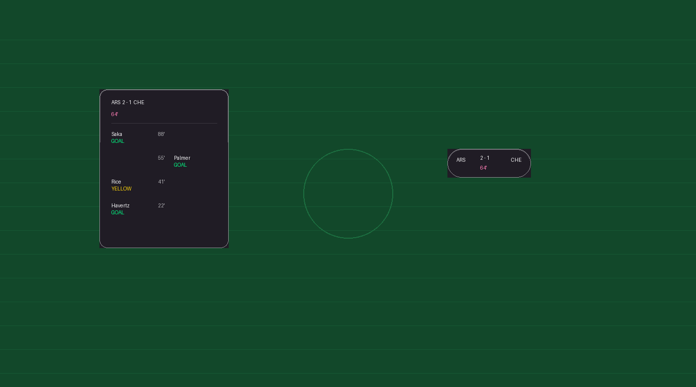

# Football Floater

Desktop **live-score overlay** for football broadcasts. Glass ticker, movable control dock, free-float match pills, multi-monitor aware. Scores come from ESPN (Premier League, Bundesliga, La Liga).

Built for watching a stream: stay on top, chroma-key friendly, out of the way until you need it.

---

## Screenshots

Add PNGs under [`docs/screenshots/`](docs/screenshots/). Until then, placeholders below document what each shot should show.

### 1. Running-text ticker



*Glass score capsule over the pitch. Each match shows home/away crests, score, and clock (live minute, `FT`, or `KO in …` countdown). The strip scrolls when there are more matches than fit.*

### 2. Control dock



*Separate movable **Live** dock: Refresh, Test notification, Float, Rearrange, Hidden, Settings, Mini, Quit. Drag it anywhere; position is saved. Mini mode collapses to icons only.*

### 3. Start / Settings



*Draggable glass settings (also the startup “what to watch?” panel). Pick leagues, past/live/future filters, theme, and which display owns the overlay. Centered on the chosen monitor — not glued to the dock.*

### 4. Free-float pills



*Float on: ticker hides; each match becomes a draggable pill. Right-click to hide; **Rearrange** restacks visible pills on the chosen display. Positions persist across restarts.*

### 5. Float goal toast



*Goal / sub toast beside a pill, with a chat tip aimed at the owner. Placement walks 360° around the pill for an empty, in-bounds slot. Short TTL (~8s) so it does not cover the pitch.*

### 6. Running-text goal toast



*In running-text mode the toast lives in a band above the glass and scrolls with its match chip (~60s). Switching Float ↔ running-text re-homes open alerts and retargets TTL.*

### 7. Match timeline



*Click a chip or pill for the timeline: score header, live clock or KO countdown, then events. Home on the left of the minute, away on the right. Pre-match empty state stays compact (header only).*

---

## Features

- **Running-text ticker** — scrolling glass capsule for the matchday slate
- **Free-float pills** — per-match overlays you can drag, hide, rearrange
- **Goal / sub toasts** — follow the match (ticker strip or speech tip on pills)
- **Timeline** — goals, cards, assists, grouped same-minute subs
- **Matchday window** — local 06:00 → next 06:00 (late kicks stay in)
- **Filters** — leagues, past / live / future; live-seen FT kept until restart
- **Themes** — default, experimental (PL × Bundesliga), macOS-style glass
- **Multi-monitor** — pick display; ticker/dock remember position with off-screen fallback

Visual tokens and behavior detail: [`DESIGN.md`](DESIGN.md).

---

## Run

```bash
pip install -r requirements.txt
python main.py
# or
python -m football_floater
```

| Platform | Notes |
|---|---|
| Windows | Tk `transparentcolor` chroma key (`#FF00FF`) |
| Linux / macOS | Same path when the compositor allows; otherwise solid panels |

Needs network access to ESPN scoreboards.

---

## Usage (short)

1. On launch, choose leagues / filters / theme / display (or skip next time).
2. **Running-text** (Float off): scores scroll in the capsule; click a match for timeline.
3. **Float on**: pills appear; drag to place; **Rearrange** to restack; **Hidden** to restore.
4. **Test** fires a fake goal toast on the first match (handy to check placement).
5. Dock and ticker positions save to `settings.json`; pill spots to `pill_positions.json`.

---

## Project layout

```
main.py                     # thin entry
football_floater/
  config.py                 # sizes, timing, settings paths
  theme.py                  # palette, glass / speech-bubble / buttons
  monitors.py               # multi-display detect
  matchday.py               # 06:00 local slate + countdown helpers
  espn.py                   # API URLs
  overlay.py                # topmost / chroma helpers
  app.py                    # SmartTicker (data loop + ticker + float)
  widgets/                  # dock, pills, timeline, settings, toasts
docs/screenshots/           # README images (see folder README)
DESIGN.md                   # UI / behavior guide
```

Settings files sit next to the repo root: `settings.json`, `pill_positions.json`.

---

## Remote

`git@github.com:NawfalHadi/football_floater.git`
